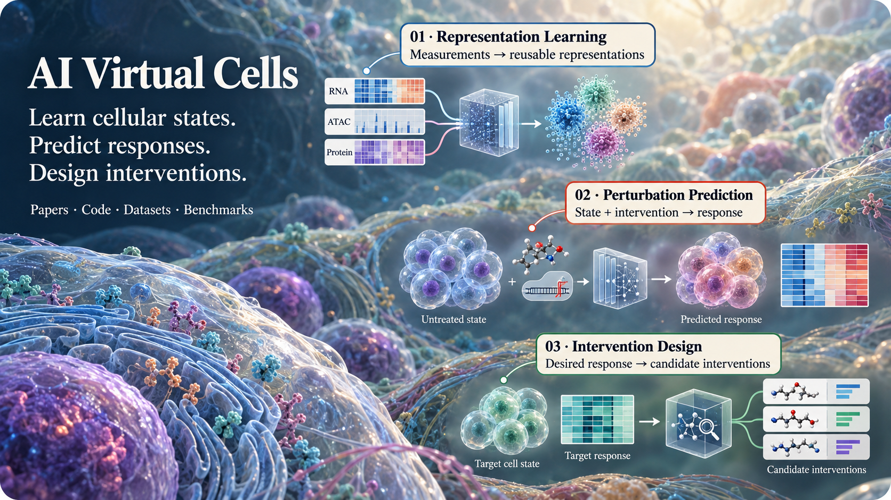

<h1 align="center">
  
  Awesome AI Virtual Cells
</h1>

**Representation Learning · Perturbation Prediction · Intervention Design**

A curated collection of public papers, code, datasets and benchmarks for AI virtual cells.

[Browse catalogue](index.html) · [Contribute](CONTRIBUTING.md)

## About

This collection organizes research around three tasks: learning cellular representations, predicting responses to perturbations, and finding interventions for desired outcomes. It covers RNA, chromatin, protein and spatial measurements.

| Task | Question | Typical output |
|---|---|---|
| **[State representation learning](#state-representation)** | How can cellular measurements be encoded into reusable representations? | Cell or gene embeddings, aligned modalities, reconstructed measurements |
| **[Perturbation-response prediction](#perturbation-prediction)** | Given a reference state and an intervention, what response will follow? | Molecular profiles, response distributions, trajectories, population or tissue changes |
| **[Intervention discovery and design](#intervention-design)** | Given a current state and a desired outcome, which intervention should be selected or generated? | Ranked targets, drug combinations, candidate molecules |

Methods are listed under their principal task. Computational components are labeled **T** Transformer, **G** GNN, **D** diffusion / flow matching, **L** latent generative, **S** statistical / mathematical, **A** agentic, and **N** other architectures. Multiple symbols indicate combined components. RNA, ATAC, DNA, Protein and Spatial are measurement labels.

**Connections between tasks.** STATE and Stack combine representation pretraining with response learning. Geneformer includes downstream in silico intervention analyses, while PertMind includes reverse perturbation identification. Their entries link to these related tasks. [Reading guide →](docs/READING_GUIDE.md)

## Updates

- **2026-10-22:** Organized the collection into representation learning, perturbation-response prediction and intervention discovery and design, with supporting data and evaluation resources.

## Contents

- [1. State representation learning (85)](#state-representation)
- [2. Perturbation-response prediction (69)](#perturbation-prediction)
- [3. Intervention discovery and design (9)](#intervention-design)
- [Experimental assays and data resources (35)](#assays-datasets)
- [Benchmarks and evaluation (23)](#benchmarks-evaluation)
- [Background and reviews (3)](#background)
- [Additional resources (17)](#additional-resources)

- [Reading guide](docs/READING_GUIDE.md)
- [Catalogue contents and link sources](docs/COVERAGE.md)
- [Code links to add](docs/PENDING_LINKS.md)

---

## 1. State representation learning

Cell and gene representations, multimodal alignment, reconstruction and transfer learning.

### Transformer-based models

- **CAPTAIN** — `Nature Communications 2026` `T`. [[paper](https://doi.org/10.1038/s41467-026-72882-y)] [[code](https://github.com/iamjiboya/CAPTAIN)]  
  CAPTAIN: a multimodal foundation model pretrained on co-assayed single-cell RNA and protein.  
  `RNA, Protein`

- **CELLama** — `Advanced Science 2026` `T`. [[paper](https://doi.org/10.1002/advs.202513210)]  
  CELLama: Foundation Model for Single Cell and Spatial Transcriptomics by Cell Embedding Leveraging Language Model Abilities.

- **CellTok** — `bioRxiv 2026` `T`. [[paper](https://www.biorxiv.org/content/10.1101/2025.10.22.684047v2)]  
  Tokenizing single-cell transcriptomes as a native language for large language models.

- **CellVQ** — `Nature Communications 2026` `T`. [[paper](https://doi.org/10.1038/s41467-026-70071-5)] [[code](https://github.com/A4Bio/CellVQ)]  
  Illuminating cell states by a comprehensive and interpretable single cell foundation model.  
  `RNA`

- **CellWhisperer** — `Nature Biotechnology 2026` `T`. [[paper](https://doi.org/10.1038/s41587-025-02857-9)] [[code](https://github.com/epigen/cellwhisperer)]  
  Multimodal learning enables chat-based exploration of single-cell data.

- **CLM-Access** — `Proceedings of the AAAI Conference on Artificial Intelligence 2026` `T`. [[paper](https://doi.org/10.1609/aaai.v40i1.37046)]  
  CLM-Access: A Specialized Foundation Model for High-Dimensional Single-Cell ATAC-Seq Analysis.

- **CLM-X** — `bioRxiv 2026` `T`. [[paper](https://doi.org/10.64898/2026.02.17.704943)]  
  CLM-X: A multimodal single-cell foundation model with flexible multi-way Transformer for unified scRNA-seq and scATAC-seq analysis.  
  `RNA, ATAC`

- **Geneformer-V2** — `Nature Computational Science 2026` `T`. [[paper](https://doi.org/10.1038/s43588-026-00972-4)] [[code](https://huggingface.co/ctheodoris/Geneformer)]  
  Scaling and quantization of large-scale foundation model enables resource-efficient predictions in network biology.  
  `RNA`

- **RVQ-Alpha** — `bioRxiv 2026` `T`. [[paper](https://doi.org/10.64898/2026.04.20.719773)]  
  RVQ-Alpha: Bridging Single-Cell Transcriptomics and Large Language Models via Hierarchical Discrete Tokenization and Fact-Aware Reinforcement Learning.

- **scMMGPT** — `Proceedings of the 32nd ACM SIGKDD Conference on Knowledge Discovery and Data Mining V.2 2026` `T`. [[paper](https://doi.org/10.1145/3770855.3819031)]  
  Language-Enhanced Representation Learning for Single-Cell Transcriptomics.

- **scTranslator** — `Nature Biomedical Engineering 2026` `T`. [[paper](https://doi.org/10.1038/s41551-025-01528-z)] [[code](https://github.com/TencentAILabHealthcare/scTranslator)]  
  A pre-trained large generative model for translating single-cell transcriptomes to proteomes.  
  `RNA`

- **SQUALL** — `bioRxiv 2026` `T`. [[paper](https://www.biorxiv.org/content/10.64898/2026.06.01.729028v2)]  
  A multimodal foundation model to integrate histology with spatial molecular programs.

- **STORM** — `arXiv 2026` `T`. [[paper](https://arxiv.org/abs/2604.03630)]  
  A Multimodal Foundation Model of Spatial Transcriptomics and Histology for Biological Discovery and Clinical Prediction.

- **TranscriptFormer** — `Science 2026` `T`. [[paper](https://doi.org/10.1126/science.aec8514)] [[code](https://github.com/czi-ai/transcriptformer)]  
  TranscriptFormer: A generative cell atlas across 1.5 billion years of evolution.  
  `RNA`

- **UCE** — `Nature 2026` `T`. [[paper](https://doi.org/10.1038/s41586-026-10689-z)] [[code](https://github.com/snap-stanford/uce)]  
  Universal cell embedding provides a foundation model for cell biology.  
  `RNA`

- **AIDO.Tissue** — `bioRxiv 2025` `T`. [[paper](https://doi.org/10.1101/2025.07.04.663102)]  
  AIDO.Tissue: Spatial Cell-Guided Pretraining for Scalable Spatial Transcriptomics Foundation Model.  
  `RNA, Spatial`

- **Atacformer** — `bioRxiv 2025` `T`. [[paper](https://doi.org/10.1101/2025.11.03.685753)]  
  Atacformer: A transformer-based foundation model for analysis and interpretation of ATAC-seq data.  
  `ATAC`

- **C2S-Scale** — `bioRxiv 2025` `T`. [[paper](https://doi.org/10.1101/2025.04.14.648850)] [[code](https://github.com/vandijklab/cell2sentence)]  
  Scaling Large Language Models for Next-Generation Single-Cell Analysis.

- **CellHermes** — `bioRxiv 2025` `T`. [[paper](https://doi.org/10.1101/2025.11.07.687322)]  
  Language may be all omics needs: Harmonizing multimodal data for omics understanding with CellHermes.

- **ChromFound** — `NeurIPS 2025` `N` `T`. [[paper](https://papers.nips.cc/paper_files/paper/2025/hash/6f4c216895c2c424ee328fcdde9cc314-Abstract-Conference.html)] [[code](https://github.com/JohnsonKlose/ChromFound)]  
  ChromFound: Towards A Universal Foundation Model for Single-Cell Chromatin Accessibiltiy Data.  
  `ATAC`

- **EpiAgent** — `Nature Methods 2025` `T`. [[paper](https://doi.org/10.1038/s41592-025-02822-z)] [[code](https://github.com/xy-chen16/EpiAgent)]  
  EpiAgent: foundation model for single-cell epigenomics.  
  `ATAC`

- **EpiFoundation** — `bioRxiv 2025` `T`. [[paper](https://doi.org/10.1101/2025.02.05.636688)]  
  EpiFoundation: a foundation model for single-cell ATAC-seq via peak-to-gene alignment.  
  `RNA, ATAC`

- **GeneJepa** — `bioRxiv 2025` `T`. [[paper](https://doi.org/10.1101/2025.10.14.682378)] [[code](https://github.com/BiostateAI/GeneJEPA)]  
  GeneJepa: A Predictive World Model of the Transcriptome.

- **GET** — `Nature 2025` `T`. [[paper](https://doi.org/10.1038/s41586-024-08391-z)] [[code](https://github.com/GET-Foundation)]  
  A foundation model of transcription across human cell types.  
  `ATAC`

- **InstructCell** — `arXiv 2025` `T`. [[paper](https://arxiv.org/abs/2501.08187)] [[code](https://github.com/zjunlp/InstructCell)]  
  A Multi-Modal AI Copilot for Single-Cell Analysis with Instruction Following.

- **KRONOS** — `arXiv 2025` `T`. [[paper](https://arxiv.org/abs/2506.03373)] [[code](https://github.com/mahmoodlab/KRONOS)]  
  A foundation model for spatial proteomics.  
  `Protein, Spatial`

- **Nicheformer** — `Nature Methods 2025` `T`. [[paper](https://doi.org/10.1038/s41592-025-02814-z)] [[code](https://github.com/theislab/nicheformer)]  
  Nicheformer: a foundation model for single-cell and spatial omics.  
  `RNA, Spatial`

- **OmiCLIP** — `Nature Methods 2025` `T`. [[paper](https://doi.org/10.1038/s41592-025-02707-1)] [[code](https://github.com/GuangyuWangLab2021/Loki)]  
  A visual--omics foundation model to bridge histopathology with spatial transcriptomics.

- **OmniCell** — `bioRxiv 2025` `T`. [[paper](https://doi.org/10.64898/2025.12.29.696804)] [[code](https://github.com/BGIResearch/omnicell)]  
  OmniCell: Unified Foundation Modelling of Single-Cell and Spatial Transcriptomics for Cellular and Molecular Insights.  
  `RNA, Spatial`

- **PULSAR** — `bioRxiv 2025` `T`. [[paper](https://doi.org/10.1101/2025.11.24.685470)] [[code](https://github.com/snap-stanford/PULSAR)]  
  PULSAR: a Foundation Model for Multi-scale and Multi-cellular Biology.  
  `RNA`

- **scConcept** — `bioRxiv 2025` `T`. [[paper](https://doi.org/10.1101/2025.10.14.682419)] [[code](https://github.com/theislab/scConcept)]  
  scConcept: Contrastive pretraining for technology-agnostic single-cell representations beyond reconstruction.

- **scGPT-spatial** — `bioRxiv 2025` `T`. [[paper](https://doi.org/10.1101/2025.02.05.636714)] [[code](https://github.com/bowang-lab/scGPT-spatial)]  
  scGPT-spatial: continual pretraining of single-cell foundation model for spatial transcriptomics.  
  `RNA + Spatial`

- **scPRINT** — `Nature Communications 2025` `T`. [[paper](https://doi.org/10.1038/s41467-025-58699-1)] [[code](https://github.com/cantinilab/scPRINT)]  
  scPRINT: pre-training on 50 million cells allows robust gene network predictions.  
  `RNA`

- **scPRINT-2** — `bioRxiv 2025` `T`. [[paper](https://doi.org/10.64898/2025.12.11.693702)]  
  scPRINT-2: Towards the next-generation of cell foundation models and benchmarks.

- **SpaFoundation** — `bioRxiv 2025` `T`. [[paper](https://doi.org/10.1101/2025.08.07.669202)]  
  Inferring spatial gene expression from tissue images using large-scale histology foundation model with SpaFoundation.

- **SToFM** — `arXiv 2025` `T`. [[paper](https://arxiv.org/abs/2507.11588)] [[code](https://github.com/PharMolix/SToFM)]  
  SToFM: a multi-scale foundation model for spatial transcriptomics.  
  `RNA, Spatial`

- **STPath** — `npj Digital Medicine 2025` `T`. [[paper](https://doi.org/10.1038/s41746-025-02020-3)] [[code](https://github.com/Graph-and-Geometric-Learning/STPath)]  
  STPath: a generative foundation model for integrating spatial transcriptomics and whole-slide images.

- **Tabula** — `bioRxiv 2025` `T`. [[paper](https://doi.org/10.1101/2025.01.06.631427)]  
  Toward a privacy-preserving predictive foundation model of single-cell transcriptomics with federated learning and tabular modeling.  
  `RNA`

- **Tahoe-x1** — `bioRxiv 2025` `T`. [[paper](https://doi.org/10.1101/2025.10.23.683759)] [[code](https://github.com/tahoebio/tahoe-x1)]  
  Tahoe-x1: Scaling Perturbation-Trained Single-Cell Foundation Models to 3 Billion Parameters.

- **TEDDY** — `arXiv 2025` `T`. [[paper](https://arxiv.org/abs/2503.03485)]  
  TEDDY: a family of foundation models for understanding single cell biology.  
  `RNA`

- **XPressor** — `bioRxiv 2025` `T`. [[paper](https://doi.org/10.1101/2025.05.16.653447)]  
  Towards foundation models that learn across biological scales.

- **AIDO.Cell** — `bioRxiv 2024` `T`. [[paper](https://doi.org/10.1101/2024.11.28.625303)] [[code](https://github.com/genbio-ai/AIDO)]  
  Scaling dense representations for single cell with transcriptome-scale context.  
  `RNA`

- **CancerFoundation** — `bioRxiv 2024` `T`. [[paper](https://doi.org/10.1101/2024.11.01.621087)] [[code](https://github.com/BoevaLab/CancerFoundation)]  
  CancerFoundation: A single-cell RNA sequencing foundation model to decipher drug resistance in cancer.

- **Cell2Sentence** — `ICML 2024` `T`. [[paper](https://proceedings.mlr.press/v235/levine24a.html)] [[code](https://github.com/vandijklab/cell2sentence)]  
  Cell2Sentence: Teaching Large Language Models the Language of Biology.

- **CellPLM** — `ICLR 2024` `T` `L`. [[paper](https://proceedings.iclr.cc/paper_files/paper/2024/hash/173bcdbd820edbe43284e0941109ada9-Abstract-Conference.html)] [[code](https://github.com/OmicsML/CellPLM)]  
  CellPLM: Pre-training of cell language model beyond single cells.  
  `RNA, Spatial`

- **GeneCompass** — `Cell Research 2024` `T`. [[paper](https://doi.org/10.1038/s41422-024-01034-y)] [[code](https://github.com/xCompass-AI/GeneCompass)]  
  GeneCompass: deciphering universal gene regulatory mechanisms with a knowledge-informed cross-species foundation model.  
  `RNA`

- **LangCell** — `arXiv 2024` `T`. [[paper](https://arxiv.org/abs/2405.06708)] [[code](https://github.com/PharMolix/LangCell)]  
  LangCell: Language-Cell Pre-training for Cell Identity Understanding.

- **scCello** — `arXiv 2024` `T`. [[paper](https://arxiv.org/abs/2408.12373)] [[code](https://github.com/DeepGraphLearning/scCello)]  
  Cell-ontology guided transcriptome foundation model.

- **scFoundation** — `Nature Methods 2024` `T`. [[paper](https://doi.org/10.1038/s41592-024-02305-7)] [[code](https://github.com/biomap-research/scFoundation)]  
  Large-scale foundation model on single-cell transcriptomics.  
  `RNA`

- **scGPT** — `Nature Methods 2024` `T`. [[paper](https://doi.org/10.1038/s41592-024-02201-0)] [[code](https://github.com/bowang-lab/scGPT)]  
  scGPT: toward building a foundation model for single-cell multi-omics using generative AI.  
  `RNA`

- **scMulan** — `Proceedings of the International Conference on Research in Computational Molecular Biology 2024` `T`. [[paper](https://doi.org/10.1007/978-1-0716-3989-4_57)]  
  scMulan: a multitask generative pre-trained language model for single-cell analysis.  
  `RNA`

- **ST-Align** — `arXiv 2024` `T`. [[paper](https://arxiv.org/abs/2411.16793)]  
  ST-Align: A Multimodal Foundation Model for Image-Gene Alignment in Spatial Transcriptomics.

- **stFormer** — `bioRxiv 2024` `T`. [[paper](https://doi.org/10.1101/2024.09.27.615337)]  
  stFormer: a foundation model for spatial transcriptomics.

- **Geneformer** — `Nature 2023` `T`. [[paper](https://doi.org/10.1038/s41586-023-06139-9)] [[code](https://huggingface.co/ctheodoris/Geneformer)]  
  Transfer learning enables predictions in network biology.  
  `RNA` · Related task: [Intervention discovery and design](#intervention-design)

- **tGPT** — `iScience 2023` `T`. [[paper](https://doi.org/10.1016/j.isci.2023.106536)]  
  Generative pretraining from large-scale transcriptomes for single-cell deciphering.

- **xTrimoGene** — `NeurIPS 2023` `T`. [[paper](https://doi.org/10.52202/075280-3039)]  
  xTrimoGene: an efficient and scalable representation learner for single-cell RNA-seq data.  
  `RNA`

- **scBERT** — `Nature Machine Intelligence 2022` `T`. [[paper](https://doi.org/10.1038/s42256-022-00534-z)] [[code](https://github.com/TencentAILabHealthcare/scBERT)]  
  scBERT as a large-scale pretrained deep language model for cell type annotation of single-cell RNA-seq data.  
  `RNA`

### Graph neural networks

- **scLong** — `Nature Communications 2026` `T` `G`. [[paper](https://doi.org/10.1038/s41467-026-69102-y)] [[code](https://github.com/BaiDing1234/scLong)]  
  scLong: a billion-parameter foundation model for capturing long-range gene context in single-cell transcriptomics.  
  `RNA`

- **SpatialFusion** — `bioRxiv 2026` `G`. [[paper](https://doi.org/10.64898/2026.03.16.712056)]  
  SpatialFusion: A lightweight multimodal foundation model for pathway-informed spatial niche mapping.

- **Cell-GraphCompass** — `National Science Review 2025` `G`. [[paper](https://doi.org/10.1093/nsr/nwaf255)] [[code](https://github.com/epang-ucas/Cell-Graph-Compass)]  
  Cell-GraphCompass: modeling single cells with graph structure foundation model.  
  `RNA`

- **Novae** — `Nature Methods 2025` `G`. [[paper](https://doi.org/10.1038/s41592-025-02899-6)] [[code](https://github.com/MICS-Lab/novae)]  
  Novae: a graph-based foundation model for spatial transcriptomics data.  
  `RNA + Spatial`

- **GLUE** — `Nature Biotechnology 2022` `G` `L`. [[paper](https://doi.org/10.1038/s41587-022-01284-4)] [[code](https://github.com/gao-lab/GLUE)]  
  Multi-omics single-cell data integration and regulatory inference with graph-linked embedding.  
  `RNA + ATAC`

### Diffusion and flow matching

- **HoloCell** — `bioRxiv 2026` `T` `D`. [[paper](https://doi.org/10.64898/2026.06.07.730684)]  
  HoloCell: A Generative Foundation Model for Holistic Cellular Modeling.

- **Lingshu-Cell** — `arXiv 2026` `T` `D`. [[paper](https://arxiv.org/abs/2603.25240)]  
  Lingshu-Cell: A generative cellular world model for transcriptome modeling toward virtual cells.

- **ScDiVa** — `arXiv 2026` `T` `D`. [[paper](https://arxiv.org/abs/2602.03477)]  
  ScDiVa: Masked Discrete Diffusion for Joint Modeling of Single-Cell Identity and Expression.

- **MorphDiff** — `Nature Communications 2025` `D`. [[paper](https://doi.org/10.1038/s41467-025-63478-z)] [[code](https://github.com/biomap-research/MorphDiff)]  
  Prediction of cellular morphology changes under perturbations with a transcriptome-guided diffusion model.

### Latent generative models

- **xVERSE** — `bioRxiv 2026` `L`. [[paper](https://doi.org/10.64898/2026.04.12.718016)] [[code](https://github.com/jichunxie/xVERSE_code)]  
  A transcriptomics-native foundation model for universal cell representation and virtual cell synthesis.  
  `RNA, Spatial`

- **multiDGD** — `Nature Communications 2024` `L`. [[paper](https://doi.org/10.1038/s41467-024-53340-z)] [[code](https://github.com/Center-for-Health-Data-Science/multiDGD)]  
  multiDGD: A versatile deep generative model for multi-omics data.

- **scButterfly** — `Nature Communications 2024` `L`. [[paper](https://doi.org/10.1038/s41467-024-47418-x)] [[code](https://github.com/BioX-NKU/scButterfly)]  
  scButterfly: a versatile single-cell cross-modality translation method via dual-aligned variational autoencoders.

- **MultiVI** — `Nature Methods 2023` `L`. [[paper](https://doi.org/10.1038/s41592-023-01909-9)] [[code](https://github.com/scverse/scvi-tools)]  
  MultiVI: deep generative model for the integration of multimodal data.  
  `RNA + ATAC`

- **PeakVI** — `Cell Reports Methods 2022` `L`. [[paper](https://doi.org/10.1016/j.crmeth.2022.100182)] [[code](https://github.com/YosefLab/scvi-tools)]  
  PeakVI: A deep generative model for single-cell chromatin accessibility analysis.

- **Cobolt** — `Genome Biology 2021` `L`. [[paper](https://doi.org/10.1186/s13059-021-02556-z)] [[code](https://github.com/boyinggong/cobolt)]  
  Cobolt: integrative analysis of multimodal single-cell sequencing data.

- **totalVI** — `Nature Methods 2021` `L`. [[paper](https://doi.org/10.1038/s41592-020-01050-x)] [[code](https://github.com/YosefLab/scvi-tools)]  
  Joint probabilistic modeling of single-cell multi-omic data with totalVI.  
  `RNA + Protein`

### Other architectures and transfer methods

- **RegFormer** — `Nature Communications 2026` `N`. [[paper](https://doi.org/10.1038/s41467-026-72198-x)] [[code](https://github.com/BGIResearch/RegFormer)]  
  RegFormer: a single-cell foundation model powered by gene regulatory hierarchies.

- **scELMo** — `Patterns 2026` `N`. [[paper](https://doi.org/10.1016/j.patter.2025.101431)]  
  Embeddings from language models are good learners for single-cell data analysis.

- **scProTrans** — `Genome Biology 2026` `N`. [[paper](https://doi.org/10.1186/s13059-026-04070-6)] [[code](https://github.com/MengyuanZhaoo/ProTrans)]  
  A sequence knowledge-guided deep learning method for single-cell multi-omics translation.  
  `RNA + Protein`

- **CellFM** — `Nature Communications 2025` `N`. [[paper](https://doi.org/10.1038/s41467-025-59926-5)] [[code](https://github.com/biomed-AI/CellFM)]  
  CellFM: a large-scale foundation model pre-trained on transcriptomics of 100 million human cells.  
  `RNA`

- **GeneMamba** — `arXiv 2025` `N`. [[paper](https://arxiv.org/abs/2504.16956)] [[code](https://github.com/MineSelf2016/GeneMamba)]  
  GeneMamba: an efficient and effective foundation model on single cell data.  
  `RNA`

- **GenePT** — `Nature Biomedical Engineering 2025` `N`. [[paper](https://doi.org/10.1038/s41551-024-01284-6)] [[code](https://github.com/yiqunchen/GenePT)]  
  Simple and effective embedding model for single-cell biology built from ChatGPT.

- **SCARF** — `bioRxiv 2025` `N`. [[paper](https://doi.org/10.1101/2025.04.07.647689)]  
  SCARF: Single Cell ATAC-seq and RNA-seq Foundation model.

- **SCimilarity** — `Nature 2025` `N`. [[paper](https://doi.org/10.1038/s41586-024-08411-y)] [[code](https://github.com/Genentech/scimilarity)]  
  A cell atlas foundation model for scalable search of similar human cells.

- **scLinguist** — `bioRxiv 2025` `N`. [[paper](https://doi.org/10.1101/2025.09.30.679123)]  
  scLinguist: A pre-trained hyena-based foundation model for cross-modality translation in single-cell multi-omics.

- **SATURN** — `Nature Methods 2024` `N`. [[paper](https://doi.org/10.1038/s41592-024-02191-z)] [[code](https://github.com/snap-stanford/saturn)]  
  Toward universal cell embeddings: integrating single-cell RNA-seq datasets across species with SATURN.

- **scArches** — `Nature Biotechnology 2022`. [[paper](https://doi.org/10.1038/s41587-021-01001-7)] [[code](https://github.com/theislab/scarches)]  
  Mapping single-cell data to reference atlases by transfer learning.

- **BABEL** — `Proceedings of the National Academy of Sciences 2021` `N`. [[paper](https://doi.org/10.1073/pnas.2023070118)] [[code](https://github.com/wukevin/babel)]  
  BABEL enables cross-modality translation between multiomic profiles at single-cell resolution.  
  `RNA + ATAC`

[↑ Contents](#contents)

## 2. Perturbation-response prediction

Prediction of molecular, population, temporal and spatial responses to genetic or chemical interventions.

### Transformer-based models

- **CisTransCell** — `arXiv 2026` `T`. [[paper](https://doi.org/10.48550/arXiv.2606.13713)]  
  CisTransCell: Single-Cell Perturbation Prediction via Gene Function, Regulatory Control, and Cellular Context.  
  `RNA`

- **GenoME** — `Nucleic Acids Research 2026` `T`. [[paper](https://doi.org/10.1093/nar/gkag902)]  
  GenoME: a MoE-based generative model for individualized, multimodal prediction and perturbation of genomic profiles.  
  `RNA + ATAC + DNA`

- **MaxToki** — `bioRxiv 2026` `T`. [[paper](https://doi.org/10.64898/2026.03.30.715396)] [[code](https://github.com/NVIDIA-Digital-Bio/MaxToki)]  
  Temporal AI model predicts drivers of cell state trajectories across human aging.  
  `RNA`

- **PertMind** — `arXiv 2026` `T`. [[paper](https://arxiv.org/abs/2608.16419v3)] [[code](https://github.com/shapsider/PertMind)]  
  PertMind: Eliciting Emergent Biological Reasoning in LLM via Reinforcement Learning on Cellular Perturbation Data.  
  `RNA` · Related task: [Intervention discovery and design](#intervention-design)

- **PerturbGen** — `bioRxiv 2026` `T`. [[paper](https://doi.org/10.64898/2026.03.04.709254)] [[code](https://github.com/Lotfollahi-lab/Perturbgen)]  
  Predicting how perturbations reshape cellular trajectories with PerturbGen.  
  `RNA`

- **Pop-Corn** — `bioRxiv 2026` `T`. [[paper](https://doi.org/10.64898/2026.09.25.754560)] [[code](https://github.com/GabbyKoki/pop)]  
  Pop-Corn: Predicting Perturbation Phenotype Effects Across Single-Cell and Spatial Contexts.  
  `RNA + Spatial`

- **Stack** — `bioRxiv 2026` `T`. [[paper](https://www.biorxiv.org/content/10.64898/2026.01.09.698608v2)] [[code](https://github.com/ArcInstitute/stack)]  
  Stack: In-context learning of single-cell biology.  
  `RNA` · Related task: [State representation learning](#state-representation)

- **STATE** — `Cell 2026` `T`. [[paper](https://doi.org/10.1016/j.cell.2026.07.052)] [[code](https://github.com/ArcInstitute/state)]  
  Predicting cellular responses to perturbation across diverse contexts with State.  
  `RNA` · Related task: [State representation learning](#state-representation)

- **TMEformer** — `bioRxiv 2026` `T`. [[paper](https://doi.org/10.64898/2026.05.17.725770)]  
  Mapping Tumor-Microenvironment dependencies with TMEformer: A spatial foundation framework enabling in silico perturbation.

- **VCWorld** — `ICLR 2026` `T`. [[paper](https://proceedings.iclr.cc/paper_files/paper/2026/hash/767ff070c27c8954babe74eccf3fbe91-Abstract-Conference.html)] [[code](https://github.com/GENTEL-lab/VCWorld)]  
  VCWorld: A biological world model for virtual cell simulation.  
  `RNA`

- **TissueNarrator** — `bioRxiv 2025` `T`. [[paper](https://doi.org/10.1101/2025.11.24.690325)] [[code](https://github.com/Steven51516/tissuenarrator)]  
  TissueNarrator: Generative Modeling of Spatial Transcriptomics with Large Language Models.  
  `RNA + Spatial`

- **PertFormer** — `bioRxiv 2024` `T`. [[paper](https://doi.org/10.1101/2024.12.19.629561)] [[code](https://github.com/alibaba/damo-pertformer)]  
  Multimodal foundation model predicts zero-shot functional perturbations and cell fate dynamics.  
  `RNA + ATAC`

### Graph neural networks

- **Celcomen** — `Nature Communications 2026` `G`. [[paper](https://doi.org/10.1038/s41467-026-69856-5)] [[code](https://github.com/Teichlab/celcomen)]  
  Celcomen: spatial causal disentanglement for single-cell and tissue perturbation modeling.  
  `RNA + Spatial`

- **PEPR-GNN** — `bioRxiv 2026` `G`. [[paper](https://doi.org/10.64898/2026.05.05.722311)] [[code](https://github.com/zmutsw/PEPR-GNN)]  
  PEPR-GNN: Perturbation-Enhancer-Promoter-RNA Graph Neural Networks for Multiome Perturb-Seq modeling of regulomes.  
  `RNA + ATAC`

- **TxPert** — `Nature Biotechnology 2026` `G`. [[paper](https://doi.org/10.1038/s41587-026-03113-4)] [[code](https://github.com/valence-labs/TxPert)]  
  TxPert: using multiple knowledge graphs for prediction of transcriptomic perturbation effects.  
  `RNA`

- **SpatialProp** — `bioRxiv 2025` `G`. [[paper](https://doi.org/10.64898/2025.11.30.691355)] [[code](https://github.com/abuendia/spatial-prop)]  
  SpatialProp: tissue perturbation modeling with spatially resolved single-cell transcriptomics.  
  `RNA + Spatial`

- **AttentionPert** — `Bioinformatics 2024` `G`. [[paper](https://doi.org/10.1093/bioinformatics/btae244)] [[code](https://github.com/BaiDing1234/AttentionPert)]  
  AttentionPert: accurately modeling multiplexed genetic perturbations with multi-scale effects.  
  `RNA`

- **GEARS** — `Nature Biotechnology 2024` `G`. [[paper](https://doi.org/10.1038/s41587-023-01905-6)] [[code](https://github.com/snap-stanford/GEARS)]  
  Predicting transcriptional outcomes of novel multigene perturbations with GEARS.  
  `RNA`

### Diffusion and flow matching

- **ChromaPert** — `arXiv 2026` `D`. [[paper](https://arxiv.org/abs/2610.09054)]  
  Beyond the Transcriptome: Chromatin-Informed Prediction of Cell-State-Dependent Perturbation Responses.  
  `RNA + ATAC`

- **LCD** — `Proceedings of the National Academy of Sciences 2026` `D`. [[paper](https://doi.org/10.1073/pnas.2602630123)]  
  Latent Causal Diffusions for Single-Cell Perturbation Modeling.

- **MultiFlow** — `bioRxiv 2026` `D`. [[paper](https://doi.org/10.64898/2026.08.20.746112)] [[code](https://github.com/liuq-lab/MultiFlow)]  
  MultiFlow: coupled flow matching for predicting single-cell multiomic perturbation responses in unseen cellular contexts.  
  `RNA + ATAC`

- **PerturbDiff** — `arXiv 2026` `T` `D`. [[paper](https://doi.org/10.48550/arXiv.2602.19685)] [[code](https://github.com/DeepGraphLearning/PerturbDiff)]  
  PerturbDiff: Functional diffusion for single-cell perturbation modeling.  
  `RNA`

- **PRiMeFlow** — `arXiv 2026` `D`. [[paper](https://arxiv.org/abs/2604.13986)]  
  PRiMeFlow: Capturing Complex Expression Heterogeneity in Perturbation Response Modelling.

- **SCALE** — `bioRxiv 2026` `T` `D`. [[paper](https://doi.org/10.64898/2026.03.17.712536)]  
  SCALE: Scalable Conditional Atlas-Level Endpoint Transport for virtual cell perturbation prediction.

- **scBIG** — `arXiv 2026` `D`. [[paper](https://arxiv.org/abs/2602.04901)] [[code](https://github.com/ttruan2426-dot/scBIG)]  
  Beyond Independent Genes: Learning Module-Inductive Representations for Single-Cell Gene Perturbation Prediction.  
  `RNA`

- **scDFM** — `arXiv 2026` `T` `D`. [[paper](https://doi.org/10.48550/arXiv.2602.07103)] [[code](https://github.com/AI4Science-WestlakeU/scDFM)]  
  scDFM: Distributional flow matching model for robust single-cell perturbation prediction.  
  `RNA`

- **scDiffusion-X** — `Nature Communications 2026` `D`. [[paper](https://doi.org/10.1038/s41467-026-71744-x)] [[code](https://github.com/EperLuo/scDiffusion-X)]  
  A multi-modal diffusion model with dual-cross-attention for multi-omics data generation and translation.  
  `RNA + ATAC`

- **Squidiff** — `Nature Methods 2026` `D`. [[paper](https://doi.org/10.1038/s41592-025-02877-y)] [[code](https://github.com/siyuh/Squidiff)]  
  Squidiff: predicting cellular development and responses to perturbations using a diffusion model.  
  `RNA`

- **StateXDiff** — `arXiv 2026` `T` `D`. [[paper](https://arxiv.org/abs/2605.16104)]  
  StateXDiff: Cell State-Contextualized Multimodal Diffusion for Single-Cell Perturbation Prediction.

- **STRAND** — `arXiv 2026` `D`. [[paper](https://arxiv.org/abs/2602.10156)]  
  STRAND: Sequence-Conditioned Transport for Single-Cell Perturbations.

- **U-Pert** — `bioRxiv 2026` `D`. [[paper](https://doi.org/10.64898/2026.06.30.735555)]  
  Unbalanced Perturbation Dynamics For Cell Fate Design.

- **X-Cell** — `bioRxiv 2026` `T` `D`. [[paper](https://doi.org/10.64898/2026.03.18.712807)] [[code](https://github.com/Xaira-Therapeutics/X-Cell)] [[X-Atlas / Pisces data](https://huggingface.co/datasets/Xaira-Therapeutics/X-Atlas-Pisces)]  
  X-Cell: Scaling Causal Perturbation Prediction Across Diverse Cellular Contexts via Diffusion Language Models.

- **CellFlow** — `bioRxiv 2025` `D`. [[paper](https://doi.org/10.1101/2025.04.11.648220)] [[code](https://github.com/theislab/CellFlow)]  
  CellFlow enables generative single-cell phenotype modeling with flow matching.  
  `RNA`

- **scPPDM** — `arXiv 2025` `D`. [[paper](https://doi.org/10.48550/arXiv.2510.11726)]  
  scPPDM: A diffusion model for single-cell drug-response prediction.  
  `RNA`

### Latent generative models

- **LDC** — `arXiv 2026` `L`. [[paper](https://arxiv.org/abs/2605.25581)]  
  Learning Latent Dynamical Causal Processes for Single-Cell Perturbation Prediction.

- **MultiPert** — `PLOS Computational Biology 2026` `N` `L`. [[paper](https://doi.org/10.1371/journal.pcbi.1014054)] [[code](https://github.com/MengyuanZhaoo/MultiPert)]  
  MultiPert: An adversarial alignment and dual attention framework for single-cell multi-omics perturbation prediction.  
  `RNA + Protein`

- **RegVelo** — `Cell 2026` `L`. [[paper](https://doi.org/10.1016/j.cell.2026.04.022)] [[code](https://github.com/theislab/regvelo)]  
  RegVelo: gene-regulatory-informed dynamics of single cells.  
  `RNA`

- **CONCERT** — `bioRxiv 2025` `L`. [[paper](https://www.biorxiv.org/content/10.1101/2025.11.08.686890v2)] [[code](https://github.com/mims-harvard/CONCERT)]  
  CONCERT predicts niche-aware perturbation responses in spatial transcriptomics.  
  `RNA + Spatial`

- **DynaVelo** — `bioRxiv 2025` `L`. [[paper](https://doi.org/10.1101/2025.04.24.650458)] [[code](https://github.com/karbalayghareh/DynaVelo)]  
  Deep dynamical models of single-cell multiomic velocities predict loss-of-function and rescue perturbations in B cells.  
  `RNA + ATAC`

- **IMPA** — `Nature Communications 2025` `L`. [[paper](https://doi.org/10.1038/s41467-024-55707-8)] [[code](https://github.com/theislab/IMPA)]  
  Predicting cell morphological responses to perturbations using generative modeling.

- **PerturbNet** — `Molecular Systems Biology 2025` `L`. [[paper](https://doi.org/10.1038/s44320-025-00131-3)] [[code](https://github.com/welch-lab/PerturbNet)]  
  PerturbNet predicts single-cell responses to unseen chemical and genetic perturbations.  
  `RNA`

- **scCausalVI** — `Cell Systems 2025` `L`. [[paper](https://doi.org/10.1016/j.cels.2025.101443)]  
  scCausalVI disentangles single-cell perturbation responses with causality-aware generative model.  
  `RNA`

- **biolord** — `Nature Biotechnology 2024` `L`. [[paper](https://doi.org/10.1038/s41587-023-02079-x)] [[code](https://github.com/nitzanlab/biolord)]  
  Disentanglement of single-cell data with biolord.  
  `RNA`

- **scDisInFact** — `Nature Communications 2024` `L`. [[paper](https://doi.org/10.1038/s41467-024-45227-w)] [[code](https://github.com/ZhangLabGT/scDisInFact)]  
  scDisInFact: disentangled learning for integration and prediction of multi-batch multi-condition single-cell RNA-sequencing data.  
  `RNA`

- **scLAMBDA** — `bioRxiv 2024` `L`. [[paper](https://doi.org/10.1101/2024.12.04.626878)] [[code](https://github.com/gefeiwang/scLAMBDA)]  
  Modeling and predicting single-cell multi-gene perturbation responses with scLAMBDA.  
  `RNA`

- **scPRAM** — `Bioinformatics 2024` `L` `S`. [[paper](https://doi.org/10.1093/bioinformatics/btae265)] [[code](https://github.com/jiang-q19/scPRAM)]  
  scPRAM accurately predicts single-cell gene expression perturbation response based on attention mechanism.

- **SCREEN** — `Frontiers of Computer Science 2024` `L` `S`. [[paper](https://doi.org/10.1007/s11704-024-31014-9)] [[code](https://github.com/Califorya/SCREEN)]  
  SCREEN: predicting single-cell gene expression perturbation responses via optimal transport.

- **CPA** — `Molecular Systems Biology 2023` `L`. [[paper](https://doi.org/10.15252/msb.202211517)] [[code](https://github.com/theislab/cpa)]  
  Predicting cellular responses to complex perturbations in high-throughput screens.  
  `RNA`

- **scVIDR** — `Patterns 2023` `L`. [[paper](https://doi.org/10.1016/j.patter.2023.100817)] [[code](https://github.com/BhattacharyaLab/scVIDR)]  
  Generative modeling of single-cell gene expression for dose-dependent chemical perturbations.  
  `RNA`

- **chemCPA** — `NeurIPS 2022` `L`. [[paper](https://doi.org/10.52202/068431-1937)] [[code](https://github.com/theislab/chemCPA)]  
  Predicting cellular responses to novel drug perturbations at a single-cell resolution.  
  `RNA`

- **scPreGAN** — `Bioinformatics 2022` `L`. [[paper](https://doi.org/10.1093/bioinformatics/btac357)] [[code](https://github.com/JaneJiayiDong/scPreGAN)]  
  scPreGAN, a deep generative model for predicting the response of single-cell expression to perturbation.  
  `RNA`

- **trVAE** — `Bioinformatics 2020` `L`. [[paper](https://doi.org/10.1093/bioinformatics/btaa800)] [[code](https://github.com/theislab/trVAE)]  
  Conditional out-of-distribution generation for unpaired data using transfer VAE.  
  `RNA`

- **scGen** — `Nature Methods 2019` `L`. [[paper](https://doi.org/10.1038/s41592-019-0494-8)] [[code](https://github.com/theislab/scgen)]  
  scGen predicts single-cell perturbation responses.  
  `RNA`

### Statistical and mathematical methods

- **CMonge** — `Nature Machine Intelligence 2026` `S`. [[paper](https://doi.org/10.1038/s42256-026-01242-8)] [[code](https://github.com/AI4SCR/Conditional-Monge)]  
  Conditional Monge Gap enables generalizable single-cell perturbation modelling.  
  `RNA + Protein + Image`

- **D-SPIN** — `Cell 2026` `S`. [[paper](https://doi.org/10.1016/j.cell.2026.04.028)]  
  D-SPIN constructs regulatory network models from scRNA-seq that reveal organizing principles of perturbation response.  
  `RNA`

- **CIPHER** — `bioRxiv 2025` `S`. [[paper](https://doi.org/10.1101/2025.06.27.661814)]  
  Co-fluctuations of genes in single cells predict transcriptome-wide outcomes to perturbations.

- **GPerturb** — `Nature Communications 2025` `S`. [[paper](https://doi.org/10.1038/s41467-025-61165-7)] [[code](https://github.com/hwxing3259/GPerturb)]  
  GPerturb: Gaussian process modelling of single-cell perturbation data.

- **SpaceTravLR** — `bioRxiv 2025` `S`. [[paper](https://doi.org/10.1101/2025.11.13.688264)] [[code](https://github.com/jishnu-lab/SpaceTravLR)]  
  Characterizing spatial functional microniches with SpaceTravLR.  
  `RNA + Spatial`

- **CellOracle** — `Nature 2023` `S`. [[paper](https://doi.org/10.1038/s41586-022-05688-9)] [[code](https://github.com/morris-lab/CellOracle)]  
  Dissecting cell identity via network inference and in silico gene perturbation.  
  `RNA`

- **CellOT** — `Nature Methods 2023` `S`. [[paper](https://doi.org/10.1038/s41592-023-01969-x)] [[code](https://github.com/bunnech/cellot)] [[Archived code](https://doi.org/10.3929/ethz-b-000612005)]  
  Learning single-cell perturbation responses using neural optimal transport.  
  `RNA`

- **CINEMA-OT** — `Nature Methods 2023` `S`. [[paper](https://doi.org/10.1038/s41592-023-02040-5)] [[code](https://github.com/vandijklab/CINEMA-OT)]  
  Causal identification of single-cell experimental perturbation effects with CINEMA-OT.  
  `RNA`

- **CellDrift** — `Briefings in Bioinformatics 2022` `S`. [[paper](https://doi.org/10.1093/bib/bbac324)] [[code](https://github.com/KANG-BIOINFO/CellDrift)]  
  CellDrift: inferring perturbation responses in temporally sampled single-cell data.  
  `RNA`

### Agent-based response models

- **veloAgent** — `Molecular Systems Biology 2026` `A` `L`. [[paper](https://doi.org/10.1038/s44320-026-00213-w)] [[code](https://github.com/mcgilldinglab/veloAgent)]  
  Dissecting and steering cell dynamics using spatially-informed RNA velocity with veloAgent.  
  `RNA + Spatial`

### Other architectures and transfer methods

- **CORE** — `arXiv 2026`. [[paper](https://doi.org/10.48550/arXiv.2606.01042)]  
  Plausibility Is Not Prediction: Contrastive Evidence for LLM-Based Cellular Perturbation Reasoning.

- **ProteinTalks (journal)** — `Nature 2026`. [[paper](https://doi.org/10.1038/s41586-026-11001-9)] [[code](https://github.com/guomics-lab/PTV-1)]  
  An operational perturbation proteomics-based virtual cell model.  
  `Protein`

- **Scouter** — `Nature Computational Science 2026` `N`. [[paper](https://doi.org/10.1038/s43588-025-00912-8)] [[code](https://github.com/PancakeZoy/scouter)]  
  Scouter predicts transcriptional responses to genetic perturbations with large language model embeddings.  
  `RNA`

- **GARM** — `bioRxiv 2025` `N`. [[paper](https://doi.org/10.1101/2025.10.03.680360)]  
  Gradient-aware modeling advances AI-driven prediction of genetic perturbation effects.

- **ProteinTalks** — `bioRxiv 2025` `N`. [[paper](https://doi.org/10.1101/2025.02.07.637070)] [[Current ProteinTalks implementation (journal version)](https://github.com/guomics-lab/PTV-1)]  
  A perturbation proteomics-based foundation model for virtual cell construction.

- **Waddington-OT** — `Cell 2019`. [[paper](https://doi.org/10.1016/j.cell.2019.01.006)]  
  Optimal-transport analysis of single-cell gene expression identifies developmental trajectories in reprogramming.

[↑ Contents](#contents)

## 3. Intervention discovery and design

Retrieval, inverse prediction, optimization and generation of interventions for a desired outcome. Closed-loop experiment selection is listed separately within this task.

### Retrieval and target prioritization

- **TwinCell** — `bioRxiv 2026` `S`. [[paper](https://www.biorxiv.org/content/10.64898/2026.01.29.702072v2)]  
  TwinCell: Large Causal Cell Model for Reliable and Interpretable Therapeutic Target Prioritisation.  
  `RNA`

- **PAIRING** — `Cell Systems 2025` `L`. [[paper](https://doi.org/10.1016/j.cels.2025.101405)] [[code](https://doi.org/10.5281/zenodo.15848686)]  
  Identifying an optimal perturbation to induce a desired cell state by generative deep learning.  
  `RNA`

### Direct inverse prediction

- **CellNavi** — `Nature Cell Biology 2025` `T`. [[paper](https://doi.org/10.1038/s41556-025-01755-1)] [[code](https://github.com/DLS5-Omics/CellNavi)]  
  CellNavi predicts genes directing cellular transitions by learning a gene graph-enhanced cell state manifold.  
  `RNA` · Related task: [State representation learning](#state-representation)

- **PDGrapher** — `bioRxiv 2024` `G`. [[paper](https://doi.org/10.1101/2024.01.03.573985)] [[code](https://github.com/mims-harvard/PDGrapher)]  
  Combinatorial prediction of therapeutic perturbations using causally-inspired neural networks.  
  `RNA` · Related task: [Perturbation-response prediction](#perturbation-prediction)

### Predictor-guided optimization and search

- **PHAROS** — `bioRxiv 2026` `S`. [[paper](https://doi.org/10.64898/2026.09.08.749477)]  
  PHAROS: turning single-cell perturbation models into target-directed drug-combination screens.  
  `RNA`

- **Morpheus** — `Nature Biomedical Engineering 2025` `N`. [[paper](https://doi.org/10.1038/s41551-025-01357-0)] [[code](https://github.com/neonine2/morpheus-spatial)]  
  Identifying perturbations that boost T-cell infiltration into tumours via counterfactual learning of their spatial proteomic profiles.  
  `Protein + Spatial`

### Conditional generation of interventions

- **CURE** — `ICML 2026` `T` `D`. [[paper](https://proceedings.mlr.press/v306/xu26ck.html)]  
  Reading the Cell, Designing the Cure: Perturbation-Conditioned Molecular Diffusion for Function-Oriented Drug Design.  
  `RNA`

### Closed-loop experiment selection

- **Active intervention design** — `Nature Machine Intelligence 2023`. [[paper](https://doi.org/10.1038/s42256-023-00719-0)]  
  Active learning for optimal intervention design in causal models.

- **BacterAI** — `Nature Microbiology 2023`. [[paper](https://doi.org/10.1038/s41564-023-01376-0)]  
  BacterAI maps microbial metabolism without prior knowledge.

[↑ Contents](#contents)

## Experimental assays and data resources

Cell atlases, perturbation screens, paired assays and spatial data resources.

- **CLIM-TIME** — `Cell 2026`. [[paper](https://doi.org/10.1016/j.cell.2025.12.042)]  
  CLIM-TIME identifies metastatic microenvironment modulators for T cell therapy response.

- **icCITE-plex / DOGMA-plex** — `bioRxiv 2026`. [[paper](https://doi.org/10.64898/2026.05.23.727396)]  
  Massively multiplex multimodal chemical screens at single-cell resolution.

- **Perturb-DBiT** — `Nature Biotechnology 2026`. [[paper](https://doi.org/10.1038/s41587-026-03127-y)] [[code](https://github.com/abaysoy/Perturb_DBiT)]  
  Large-scale, spatially resolved panoramic CRISPR screening in native tissue environments using Perturb-DBiT.  
  `RNA, Spatial`

- **PerturbFate** — `Nature 2026`. [[paper](https://doi.org/10.1038/s41586-026-10367-0)] [[code](https://github.com/JunyueCaoLab/PerturbFate)]  
  Mapping convergent regulators of melanoma drug resistance by PerturbFate.  
  `RNA, ATAC`

- **Primary CD4+ T-cell Perturb-seq** — `Cell 2026`. [[paper](https://doi.org/10.1016/j.cell.2026.08.002)]  
  Genome-scale perturb-seq in primary human CD4+ T cells maps context-specific regulators of T cell programs and human immune traits.  
  `RNA`

- **scBaseCount** — `Cell 2026`. [[paper](https://doi.org/10.1016/j.cell.2026.08.025)] [[code](https://github.com/ArcInstitute/arc-virtual-cell-atlas)]  
  scBaseCount: An AI agent-curated, standardized, auto-updated single-cell data repository.  
  `RNA`

- **SPAC-seq** — `Cell 2026`. [[paper](https://doi.org/10.1016/j.cell.2026.04.049)]  
  Uncovering spatially resolved functional genomics with CRISPR screen sequencing.  
  `RNA, Spatial`

- **Spatial Perturb-seq** — `Nature Communications 2026`. [[paper](https://doi.org/10.1038/s41467-026-69677-6)] [[code](https://github.com/kimberle9/spatialperturbseq)]  
  Spatial perturb-seq: single-cell functional genomics within intact tissue architecture.  
  `RNA, Spatial`

- **Tahoe-100M** — `Cell 2026`. [[paper](https://doi.org/10.1016/j.cell.2026.08.035)] [[code](https://github.com/ArcInstitute/arc-virtual-cell-atlas)]  
  Tahoe-100M: Mapping drug-induced molecular phenotypes at single-cell resolution.  
  `RNA`

- **CZ CELLxGENE Discover / Census** — `Nucleic Acids Research 2025`. [[paper](https://doi.org/10.1093/nar/gkae1142)] [[code](https://github.com/chanzuckerberg/cellxgene-census)]  
  CZ CELLxGENE Discover: a single-cell data platform for scalable exploration, analysis and modeling of aggregated data.  
  `RNA`

- **DISCO** — `Nucleic Acids Research 2025`. [[paper](https://doi.org/10.1093/nar/gkae1108)] [[code](https://github.com/JinmiaoChenLab/DISCOtoolkit)]  
  Rediscovering publicly available single-cell data with the DISCO platform.  
  `RNA`

- **FOXP3 / intracellular CITE screen** — `Nature 2025`. [[paper](https://doi.org/10.1038/s41586-025-08795-5)] [[code](https://github.com/agiguelay/Perturb-icCITEseq)]  
  Genome-wide CRISPR screen in human T cells reveals regulators of FOXP3.

- **hECA v2.0** — `Scientific Data 2025`. [[paper](https://doi.org/10.1038/s41597-025-06426-2)] [[code](https://github.com/XuegongLab/hECA-v2.0)]  
  hECA v2.0: an AI-ready ensemble cell atlas of single-cell RNA and ATAC sequencing data.  
  `RNA, ATAC`

- **Human Cytokine Dictionary** — `bioRxiv 2025`. [[paper](https://doi.org/10.64898/2025.12.12.693897)]  
  A single-cell cytokine dictionary of human peripheral blood.  
  `RNA`

- **Multiome Perturb-seq** — `Cell Systems 2025`. [[paper](https://doi.org/10.1016/j.cels.2024.12.002)]  
  Multiome Perturb-seq unlocks scalable discovery of integrated perturbation effects on the transcriptome and epigenome.  
  `RNA, ATAC`

- **Perturb-FISH** — `Cell 2025`. [[paper](https://doi.org/10.1016/j.cell.2025.02.012)] [[code](https://github.com/lbinan/Perturb-FISH)]  
  Simultaneous CRISPR screening and spatial transcriptomics reveal intracellular, intercellular, and functional transcriptional circuits.  
  `RNA, Spatial`

- **PerturBase** — `Nucleic Acids Research 2025`. [[paper](https://doi.org/10.1093/nar/gkae858)] [[code](https://github.com/bm2-lab/PerturBase)]  
  PerturBase: a comprehensive database for single-cell perturbation data analysis and visualization.  
  `RNA`

- **scPerturb** — `Nature Methods 2024`. [[paper](https://doi.org/10.1038/s41592-023-02144-y)] [[code](https://github.com/sanderlab/scPerturb)]  
  scPerturb: harmonized single-cell perturbation data.  
  `RNA`

- **Perturb-map** — `Cell 2022`. [[paper](https://doi.org/10.1016/j.cell.2022.02.015)]  
  Spatial CRISPR genomics identifies regulators of the tumor microenvironment.  
  `RNA, Protein, Spatial`

- **Replogle genome-scale screens** — `Cell 2022`. [[paper](https://doi.org/10.1016/j.cell.2022.05.013)]  
  Mapping information-rich genotype-phenotype landscapes with genome-scale Perturb-seq.  
  `RNA`

- **Tabula Sapiens** — `Science 2022`. [[paper](https://doi.org/10.1126/science.abl4896)]  
  The Tabula Sapiens: A multiple-organ, single-cell transcriptomic atlas of humans.  
  `RNA`

- **CRISPR-sciATAC** — `Nature Biotechnology 2021`. [[paper](https://doi.org/10.1038/s41587-021-00902-x)]  
  Profiling the genetic determinants of chromatin accessibility with scalable single-cell CRISPR screens.

- **Perturb-CITE-seq** — `Nature Genetics 2021`. [[paper](https://doi.org/10.1038/s41588-021-00779-1)] [[code](https://github.com/klarman-cell-observatory/Perturb-CITE-seq)]  
  Multimodal pooled Perturb-CITE-seq screens in patient models define mechanisms of cancer immune evasion.  
  `RNA, Protein`

- **Spear-ATAC** — `Nature Communications 2021`. [[paper](https://doi.org/10.1038/s41467-021-23213-w)] [[code](https://github.com/GreenleafLab/SpearATAC_MS_2021)]  
  High-throughput single-cell chromatin accessibility CRISPR screens enable unbiased identification of regulatory networks in cancer.

- **sci-Plex** — `Science 2020`. [[paper](https://doi.org/10.1126/science.aax6234)]  
  Massively multiplex chemical transcriptomics at single-cell resolution.  
  `RNA`

- **ECCITE-seq** — `Nature Methods 2019`. [[paper](https://doi.org/10.1038/s41592-019-0392-0)]  
  Multiplexed detection of proteins, transcriptomes, clonotypes and CRISPR perturbations in single cells.

- **Norman combination screen** — `Science 2019`. [[paper](https://doi.org/10.1126/science.aax4438)]  
  Exploring genetic interaction manifolds constructed from rich single-cell phenotypes.  
  `RNA`

- **Perturb-ATAC** — `Cell 2019`. [[paper](https://doi.org/10.1016/j.cell.2018.11.022)]  
  Coupled single-cell CRISPR screening and epigenomic profiling reveals causal gene regulatory networks.

- **CITE-seq** — `Nature Methods 2017`. [[paper](https://doi.org/10.1038/nmeth.4380)]  
  Simultaneous epitope and transcriptome measurement in single cells.

- **Connectivity Map / LINCS L1000** — `Cell 2017`. [[paper](https://doi.org/10.1016/j.cell.2017.10.049)]  
  A next generation connectivity map: L1000 platform and the first 1,000,000 profiles.

- **CROP-seq** — `Nature Methods 2017`. [[paper](https://doi.org/10.1038/nmeth.4177)] [[code](https://github.com/epigen/crop-seq)]  
  Pooled CRISPR screening with single-cell transcriptome readout.

- **CRISP-seq** — `Cell 2016`. [[paper](https://doi.org/10.1016/j.cell.2016.11.039)]  
  Dissecting immune circuits by linking CRISPR-pooled screens with single-cell RNA-seq.

- **Perturb-seq (Adamson)** — `Cell 2016`. [[paper](https://doi.org/10.1016/j.cell.2016.11.048)]  
  A multiplexed single-cell CRISPR screening platform enables systematic dissection of the unfolded protein response.

- **Perturb-seq (Dixit)** — `Cell 2016`. [[paper](https://doi.org/10.1016/j.cell.2016.11.038)]  
  Perturb-Seq: dissecting molecular circuits with scalable single-cell RNA profiling of pooled genetic screens.

- **Drop-seq** — `Cell 2015`. [[paper](https://doi.org/10.1016/j.cell.2015.05.002)]  
  Highly parallel genome-wide expression profiling of individual cells using nanoliter droplets.

[↑ Contents](#contents)

## Benchmarks and evaluation

Benchmarks, evaluation studies, baselines and community challenges.

- **DE classification benchmark** — `bioRxiv 2026`. [[paper](https://doi.org/10.64898/2026.07.20.739620)] [[code](https://github.com/ivysun14/Project-Perturb)]  
  Beyond Expression Prediction: Benchmarking Differential Expression Classification in Single-Cell Perturbation Models.

- **Distributional evaluation** — `bioRxiv 2026`. [[paper](https://doi.org/10.64898/2026.02.14.705879)] [[code](https://github.com/scPerturbationStudies/scPerturb-eval)]  
  Evaluating Single-Cell Perturbation Response Models Is Far from Straightforward.

- **Foundation model response benchmark** — `bioRxiv 2026`. [[paper](https://doi.org/10.64898/2026.02.18.706454)] [[code](https://github.com/genbio-ai/foundation-models-perturbation)]  
  Foundation models improve perturbation response prediction.

- **pertpy** — `Nature Methods 2026`. [[paper](https://doi.org/10.1038/s41592-025-02909-7)] [[code](https://github.com/scverse/pertpy)]  
  Pertpy: an end-to-end framework for perturbation analysis.

- **PerturbArena** — `Science Advances 2026`. [[paper](https://doi.org/10.1126/sciadv.aed3414)] [[code](https://github.com/TianGzlab/scPerturbBench)]  
  A systematic comparison of single-cell perturbation response prediction models.

- **Pretraining size and diversity evaluation** — `Nature Methods 2026`. [[paper](https://doi.org/10.1038/s41592-026-03120-y)]  
  Evaluating the role of pretraining dataset size and diversity on single-cell foundation model performance.

- **Principled evaluation** — `bioRxiv 2026`. [[paper](https://doi.org/10.64898/2026.07.23.740433)] [[code](https://github.com/Virtual-Cell-Research-Community/scPertEval)]  
  Towards principled evaluation of single-cell perturbation prediction models.

- **scArchon** — `Genome Biology 2026`. [[paper](https://doi.org/10.1186/s13059-026-04104-z)] [[code](https://github.com/hdsu-bioquant/scArchon)]  
  scArchon: a scalable benchmarking framework for assessing single-cell perturbation models.

- **scDrugPerturb-Bench** — `bioRxiv 2026`. [[paper](https://doi.org/10.64898/2026.08.19.745729)]  
  A mechanism-annotated benchmark reveals limited fidelity to drug-response signatures in single-cell perturbation models.

- **scPerturBench** — `Nature Methods 2026`. [[paper](https://doi.org/10.1038/s41592-025-02980-0)] [[code](https://github.com/bm2-lab/scPerturBench)]  
  Benchmarking algorithms for generalizable single-cell perturbation response prediction.

- **Spurious correlation audit** — `bioRxiv 2026`. [[paper](https://doi.org/10.64898/2026.05.07.723486)] [[code](https://github.com/phillipnicol/systema)]  
  Spurious correlation inflates performance in single-cell perturbation prediction.

- **Systema** — `Nature Biotechnology 2026`. [[paper](https://doi.org/10.1038/s41587-025-02777-8)] [[code](https://github.com/mlbio-epfl/systema)]  
  Systema: a framework for evaluating genetic perturbation response prediction beyond systematic variation.

- **VCBench** — `bioRxiv 2026`. [[paper](https://doi.org/10.64898/2026.06.18.733146)] [[code](https://github.com/AppliedScientific/VCBench)]  
  VCBench: A Multi-Dimensional Benchmark for Single-Cell Foundation Models.

- **Virtual Cell Challenge 2026** — `Arc Institute 2026`. [[paper](https://arcinstitute.org/news/virtual-cell-challenge-2026)]  
  The 2026 Virtual Cell Challenge: Predicting perturbation responses in cell contexts a model has never seen.

- **Foundation cell model benchmark** — `BMC Genomics 2025`. [[paper](https://doi.org/10.1186/s12864-025-11600-2)] [[code](https://github.com/turbine-ai/PerturbSeqPredBenchmark)]  
  Benchmarking foundation cell models for post-perturbation RNA-seq prediction.

- **Linear perturbation baselines** — `Nature Methods 2025`. [[paper](https://doi.org/10.1038/s41592-025-02772-6)] [[code](https://github.com/const-ae/linear_perturbation_prediction-Paper)]  
  Deep-learning-based gene perturbation effect prediction does not yet outperform simple linear baselines.

- **PertEval-scFM** — `ICML 2025`. [[paper](https://proceedings.mlr.press/v267/wenteler25a.html)] [[code](https://github.com/aaronwtr/PertEval)]  
  PertEval-scFM: benchmarking single-cell foundation models for perturbation effect prediction.

- **PerturBench** — `NeurIPS 2025`. [[paper](https://papers.nips.cc/paper_files/paper/2025/hash/8aee537279a66ced96319dfca3c00002-Abstract-Datasets_and_Benchmarks_Track.html)] [[code](https://github.com/altoslabs/perturbench)]  
  PerturBench: Benchmarking machine learning models for cellular perturbation analysis.

- **Simple controls** — `Bioinformatics 2025`. [[paper](https://doi.org/10.1093/bioinformatics/btaf317)] [[code](https://github.com/pfizer-opensource/perturb_seq)]  
  Simple controls exceed best deep learning algorithms and reveal foundation model effectiveness for predicting genetic perturbations.

- **Virtual Cell Challenge** — `Cell 2025`. [[paper](https://doi.org/10.1016/j.cell.2025.06.008)]  
  Virtual Cell Challenge: Toward a Turing test for the virtual cell.

- **Zero-shot foundation-model evaluation** — `Genome Biology 2025`. [[paper](https://doi.org/10.1186/s13059-025-03574-x)]  
  Zero-shot evaluation reveals limitations of single-cell foundation models.

- **Differential-expression false discoveries** — `Nature Communications 2021`. [[paper](https://doi.org/10.1038/s41467-021-25960-2)] [[code](https://github.com/neurorestore/DE-analysis)]  
  Confronting false discoveries in single-cell differential expression.

- **Pseudoreplication analysis** — `Nature Communications 2021`. [[paper](https://doi.org/10.1038/s41467-021-21038-1)] [[code](https://github.com/kdzimm/PseudoreplicationPaper)]  
  A practical solution to pseudoreplication bias in single-cell studies.

[↑ Contents](#contents)

## Background and reviews

Public reviews and background reading on virtual cells and perturbational biology.

- **Interpretation, extrapolation and perturbation** — `Nature Reviews Genetics 2026`. [[paper](https://doi.org/10.1038/s41576-025-00920-4)]  
  Interpretation, extrapolation and perturbation of single cells.

- **Gene function and statistical inference** — `Nature Reviews Genetics 2024`. [[paper](https://doi.org/10.1038/s41576-024-00750-w)]  
  Revealing gene function with statistical inference at single-cell resolution.

- **Perturbational single-cell omics review** — `Cell Systems 2021`. [[paper](https://doi.org/10.1016/j.cels.2021.05.016)]  
  Machine learning for perturbational single-cell omics.

[↑ Contents](#contents)

## Additional resources

Further measurement technologies, analysis tools and related computational studies.

- **Pancreatic differentiation digital twin** — `bioRxiv 2026`. [[paper](https://doi.org/10.64898/2026.04.27.721124)] [[code](https://github.com/ishahakm/scisletdigitaltwin)]  
  Predictive control of human pancreatic cell fate using a digital model of in vitro differentiation.

- **CAT-ATAC** — `Cell Reports Methods 2025`. [[paper](https://doi.org/10.1016/j.crmeth.2025.101222)] [[code](https://github.com/ucsf-lgr/catatac_public)]  
  Simultaneous capture of single cell RNA-seq, ATAC-seq, and CRISPR perturbation enables multiomic screens to identify gene regulatory relationships.

- **HEIST** — `arXiv 2025`. [[paper](https://arxiv.org/abs/2506.11152)]  
  HEIST: A Graph Foundation Model for Spatial Transcriptomics and Proteomics Data.

- **Pooled CRISPR RNA–ATAC screen** — `Nature Biotechnology 2025`. [[paper](https://doi.org/10.1038/s41587-024-02475-x)]  
  Pooled CRISPR screens with joint single-nucleus chromatin accessibility and transcriptome profiling.

- **X-Atlas / Orion** — `bioRxiv 2025`. [[paper](https://www.biorxiv.org/content/10.1101/2025.06.11.659105)]  
  X-Atlas/Orion: Genome-wide Perturb-seq Datasets via a Scalable Fix-Cryopreserve Platform for Training Dose-Dependent Biological Foundation Models.

- **CellLM** — `arXiv 2023`. [[paper](https://arxiv.org/abs/2306.04371)]  
  Large-Scale Cell Representation Learning via Divide-and-Conquer Contrastive Learning.

- **Perturb-SHARE-seq** — `Molecular Cell 2023`. [[paper](https://doi.org/10.1016/j.molcel.2023.03.013)]  
  Structural and functional properties of mSWI/SNF chromatin remodeling complexes revealed through single-cell perturbation screens.

- **Exceiver** — `arXiv 2022`. [[paper](https://arxiv.org/abs/2210.14330)] [[code](https://github.com/keiserlab/exceiver)]  
  A single-cell gene expression language model.

- **Augur** — `Nature Biotechnology 2021`. [[paper](https://doi.org/10.1038/s41587-020-0605-1)] [[code](https://github.com/neurorestore/Augur)]  
  Cell type prioritization in single-cell data.

- **ECCITE-seq / Mixscape screen** — `Nature Genetics 2021`. [[paper](https://doi.org/10.1038/s41588-021-00778-2)] [[code](https://github.com/satijalab/seurat)]  
  Characterizing the molecular regulation of inhibitory immune checkpoints with multimodal single-cell screens.

- **Normalisr** — `Nature Communications 2021`. [[paper](https://doi.org/10.1038/s41467-021-26682-1)] [[code](https://github.com/lingfeiwang/normalisr)]  
  Single-cell normalization and association testing unifying CRISPR screen and gene co-expression analyses with Normalisr.

- **SCEPTRE** — `Genome Biology 2021`. [[paper](https://doi.org/10.1186/s13059-021-02545-2)] [[code](https://github.com/Katsevich-Lab/sceptre)]  
  SCEPTRE improves calibration and sensitivity in single-cell CRISPR screen analysis.

- **scMAGeCK** — `Genome Biology 2020`. [[paper](https://doi.org/10.1186/s13059-020-1928-4)]  
  scMAGeCK links genotypes with multiple phenotypes in single-cell CRISPR screens.

- **sci-CAR** — `Science 2018`. [[paper](https://doi.org/10.1126/science.aau0730)]  
  Joint profiling of chromatin accessibility and gene expression in thousands of single cells.

- **chromVAR** — `Nature Methods 2017`. [[paper](https://doi.org/10.1038/nmeth.4401)] [[code](https://github.com/GreenleafLab/chromVAR)]  
  chromVAR: inferring transcription-factor-associated accessibility from single-cell epigenomic data.

- **General interference estimands** — `The Annals of Applied Statistics 2017`. [[paper](https://doi.org/10.1214/16-aoas1005)]  
  Estimating average causal effects under general interference, with application to a social network experiment.

- **Causal inference with interference** — `Journal of the American Statistical Association 2008`. [[paper](https://doi.org/10.1198/016214508000000292)]  
  Toward causal inference with interference.

[↑ Contents](#contents)

## Contributing

Add papers or correct links through issues and pull requests. See [CONTRIBUTING.md](CONTRIBUTING.md).

## License

Original repository code and catalogue organization use the [MIT License](LICENSE). Linked publications, datasets and implementations retain their respective licenses.
